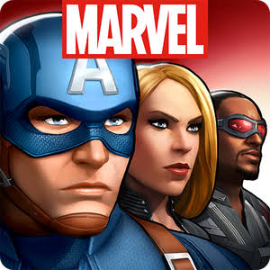

<div align="center">

  

</div>

# Marvel Avengers Alliance 2
[](../../releases/latest)
[](https://discord.gg/mNpNgD9ebv)

# Nuestra Misión 🎯:

buscamos mantener viva la experiencia de MAA 2, restaurando su contenido, personajes y mecánicas originales, mientras continuamos su desarrollo mediante mejoras, nuevas características y contenido adicional para que tanto antiguos jugadores como nuevas generaciones puedan disfrutar nuevamente de esta experiencia.

---
# Instalación 💾:

## Instalación sencilla:
<!-- - Descarga un navegador compatible con Flash. 🔦 **Recomendado:** [FlashBrowser](https://github.com/radubirsan/FlashBrowser/releases/tag/v0.81) -->
<!-- Descarga un navegador compatible con Flash, como [FlashBrowser](https://github.com/radubirsan/FlashBrowser/releases/tag/v0.81) -->
<!-- - Instala [Flash Player 32.0.0.371](https://archive.org/download/flashplayerarchive/pub/flashplayer/installers/archive/fp_32.0.0.371_archive.zip/32_0_r0_371%2Fflashplayer32_0r0_371_winpep.exe) y reinicia el navegador. Puedes encontrar alternativas [aquí](FLASH.md). -->
- Descarga la última versión desde el apartado [Releases](https://github.com/vurzk-dev/marvel-avengers-alliance-2/releases)
<!-- espacio en blanco -->
<!-- - Descarga el archivo `.zip` desde el apartado Releases -->
- Extrae el archivo `.zip` y colócalo en un lugar accesible
<!-- Markut -->
- Install y Ejecuta el archivo .APK `Alliance2.apk`
<!-- espacio en blanco -->

<!-- espacio en blanco -->
- ¡Disfruta! ❤️
---
## Licencia: [](http://www.gnu.org/licenses/gpl-3.0)

```
Marvel Avengers Alliance 2 Reimagined es un proyecto de preservación.
Copyright (C) 2026 vurzk-dev
See the GNU General Public License <https://www.gnu.org/licenses/>.
```
